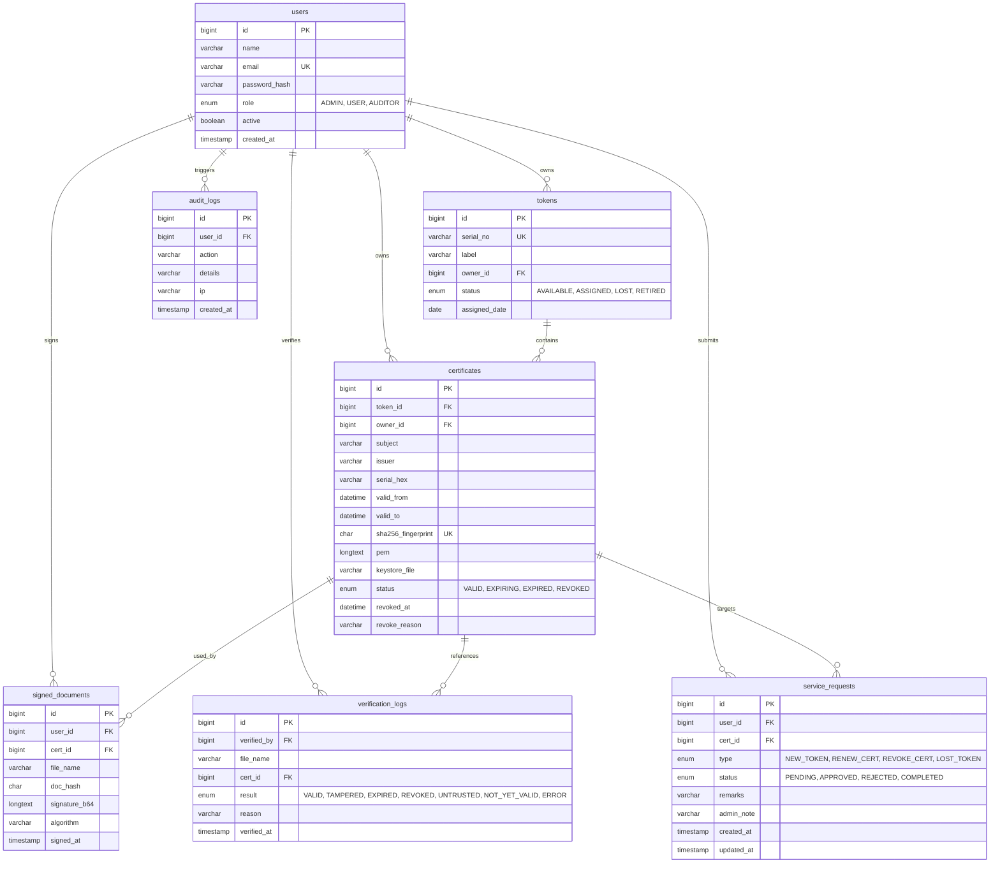
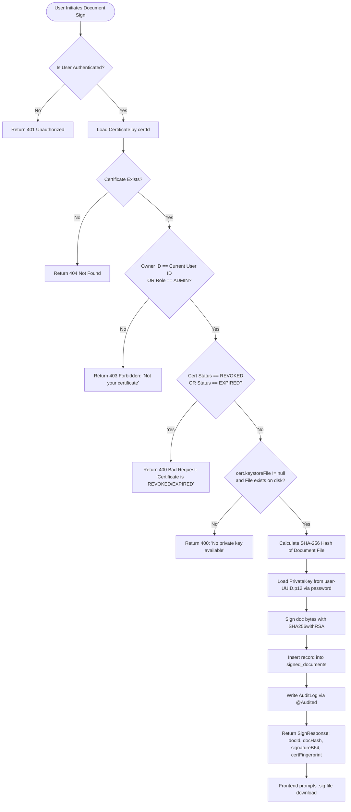
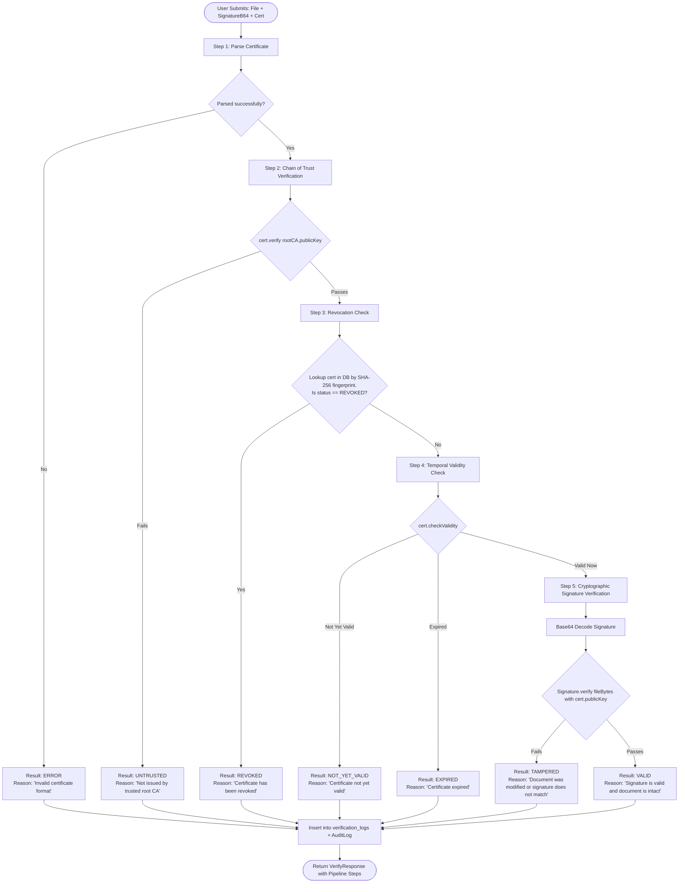
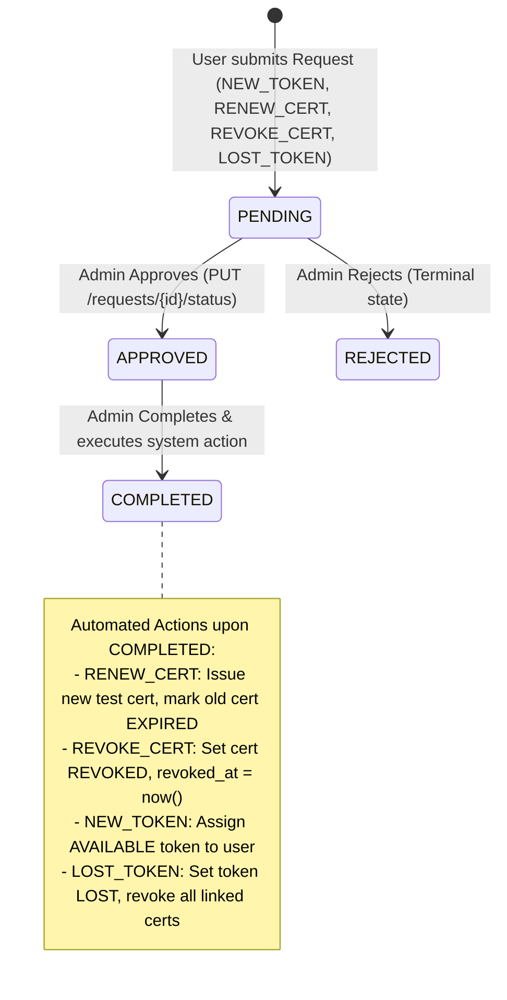
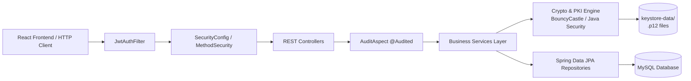
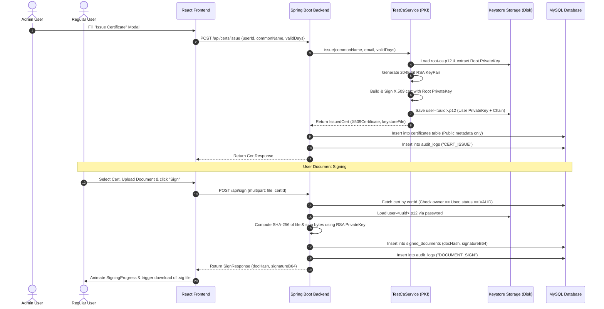
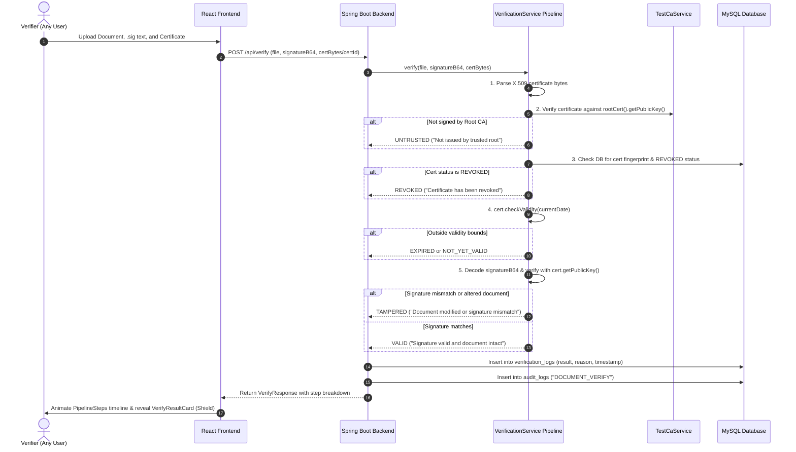

# KeyBridge: Project Understanding, Architecture, Logic & System Flows

---

## 1. Executive Project Summary

**KeyBridge** is an enterprise-grade web platform for **Digital Signature, Public Key Infrastructure (PKI), and Cryptographic Token Management**. It acts as a comprehensive, centralized bridge that provides digital certificate lifecycle management, cryptographic document signing, signature verification, token inventory tracking, automated certificate expiry monitoring, audit trails, and self-service requests.

### Core Objectives
1. **Self-Contained PKI Lifecycle**: Generate a root Certificate Authority (CA) on startup, issue X.509 v3 user test certificates, track validity, monitor expiry windows, and revoke certificates.
2. **Cryptographic Integrity & Digital Signing**: Hash documents using SHA-256 and generate RSA signatures via private keys stored securely in PKCS#12 keystores.
3. **Multi-Stage Verification Pipeline**: Run an exhaustive, ordered 5-step validation pipeline on any signed document to detect tampering, revocation, expiration, and untrusted roots.
4. **Token & Request Workflow**: Manage hardware/software token assignments and provide an auditable state machine for certificate renewal, revocation, and token provisioning.
5. **Auditing & Compliance**: Capture comprehensive audit logs for all security-sensitive actions using Spring AOP, ensuring complete non-repudiation.

---

## 2. System Constraints & Boundary Decisions

| Constraint / Decision | Rationale & Architectural Rule |
|---|---|
| **Private Key Isolation** | **CRITICAL CONSTRAINT:** Private keys are **NEVER stored in the database** or returned in API responses. Private keys reside exclusively in password-protected `.p12` (PKCS#12) files in the `keystore-data/` filesystem directory. The database stores only public metadata and PEM strings. |
| **Test PKI Scope** | Operates on an internal Test Root CA generated on startup. No external Certifying Authorities (CAs), OCSP servers, or physical PKCS#11 hardware drivers are connected (relegated to future production scope). |
| **Strict Data Segregation** | A regular user (`ROLE_USER`) can only access, view, sign with, or raise requests for their **own** certificates, tokens, and documents. `ROLE_ADMIN` has full platform access. `ROLE_AUDITOR` has read-only access to audit logs, certificates, and verifications. |
| **Data Transfer Objects (DTOs)** | Controllers **never** expose JPA entities directly. All inputs and outputs must pass through Java 17 `record` DTOs to avoid object recursion, sensitive field leakage, and database coupling. |
| **Upload Payload Boundaries** | Multipart uploads are capped at **10 MB** maximum file size. |
| **State Machine Immutability** | Illegal status transitions in Service Requests (e.g., trying to complete a REJECTED request) immediately return HTTP `409 Conflict`. |

---

## 3. Role-Based Access Control (RBAC) Matrix

| Feature / Endpoint | ADMIN | USER | AUDITOR | Anonymous / Public |
|---|:---:|:---:|:---:|:---:|
| User Authentication (`/api/auth/**`) | Yes | Yes | Yes | **Login Only** |
| User Management (`/api/users/**`) | **Full** | No | No | No |
| Token Inventory & Assignment (`/api/tokens/**`) | **Full** | Read (Own Only) | Read-Only | No |
| Issue / Revoke Certificates | **Full** | No | No | No |
| View Certificates (`/api/certs/**`) | All | Own Only | All | No |
| Sign Documents (`/api/sign`) | Yes | Yes (Own Certs) | No | No |
| Verify Signatures (`/api/verify`) | Yes | Yes | Yes | Yes (Authenticated) |
| Service Requests (`/api/requests/**`) | Approve / Reject / Complete | Create / View Own | Read-Only | No |
| Audit Logs (`/api/audit`) | Read | No | Read-Only | No |
| Dashboard & Analytics (`/api/dashboard/**`) | Full Aggregates | User Aggregates | Full Aggregates | No |


---

## 4. Development Folder Structure & Workspace Blueprint

Below is the complete architectural directory tree to be developed across the root workspace, Spring Boot backend, and React/Vite frontend.

```
keybridge/
├── SPEC.md                               # Canonical project requirements and specifications
├── PROJECT_UNDERSTANDING.md              # Architectural decisions, validation logic & flow blueprints
├── .gitignore                            # Excludes keystore-data/, node_modules/, target/, .env
├── README.md                             # Quickstart and execution runbook
│
├── keystore-data/                        # CRITICAL: Filesystem-isolated PKCS#12 key store (NEVER in DB)
│   ├── .gitignore                        # Ignores all .p12 files from Git tracking
│   ├── root-ca.p12                       # KeyBridge Test Root CA private key & root certificate
│   └── user-*.p12                        # User test certificates with chained keys (user-<uuid>.p12)
│
├── backend/                              # Spring Boot 3.x Backend (Java 17, Maven)
│   ├── pom.xml                           # Dependencies: Spring Boot Starters, BouncyCastle, JJWT, MySQL, Lombok
│   └── src/
│       ├── main/
│       │   ├── java/com/keybridge/
│       │   │   ├── KeyBridgeApplication.java       # Spring Boot main class with @EnableScheduling
│       │   │   │
│       │   │   ├── config/                         # Infrastructure & Web Configuration
│       │   │   │   ├── SecurityConfig.java         # Stateless SecurityFilterChain, BCrypt, method security
│       │   │   │   ├── CorsConfig.java             # CORS mappings allowing Vite frontend (localhost:5173)
│       │   │   │   └── AppProperties.java          # Type-safe @ConfigurationProperties for keybridge.*
│       │   │   │
│       │   │   ├── security/                       # Authentication & JWT Subsystem
│       │   │   │   ├── JwtService.java             # Token generation, signing, parsing, claims validation
│       │   │   │   ├── JwtAuthFilter.java          # OncePerRequestFilter parsing Bearer header
│       │   │   │   ├── UserDetailsServiceImpl.java # Custom UserDetailsService loading user from DB
│       │   │   │   └── UserPrincipal.java          # Custom UserDetails adapter
│       │   │   │
│       │   │   ├── entity/                         # JPA Entities (mapped to MySQL tables)
│       │   │   │   ├── User.java                   # users table (id, name, email, password_hash, role, active)
│       │   │   │   ├── Token.java                  # tokens table (serial_no, label, owner_id, status)
│       │   │   │   ├── Certificate.java            # certificates table (subject, issuer, pem, keystore_file, status)
│       │   │   │   ├── SignedDocument.java         # signed_documents table (user_id, cert_id, doc_hash, signature_b64)
│       │   │   │   ├── VerificationLog.java        # verification_logs table (verified_by, result, reason)
│       │   │   │   ├── ServiceRequest.java         # service_requests table (type, status, remarks, admin_note)
│       │   │   │   └── AuditLog.java               # audit_logs table (user_id, action, details, ip)
│       │   │   │
│       │   │   ├── enums/                          # System Enums (stored as String in JPA)
│       │   │   │   ├── Role.java                   # ADMIN, USER, AUDITOR
│       │   │   │   ├── TokenStatus.java            # AVAILABLE, ASSIGNED, LOST, RETIRED
│       │   │   │   ├── CertStatus.java             # VALID, EXPIRING, EXPIRED, REVOKED
│       │   │   │   ├── RequestType.java            # NEW_TOKEN, RENEW_CERT, REVOKE_CERT, LOST_TOKEN
│       │   │   │   ├── RequestStatus.java          # PENDING, APPROVED, REJECTED, COMPLETED
│       │   │   │   └── VerifyResult.java           # VALID, TAMPERED, EXPIRED, REVOKED, UNTRUSTED, NOT_YET_VALID, ERROR
│       │   │   │
│       │   │   ├── repository/                     # Spring Data JPA Repositories
│       │   │   │   ├── UserRepository.java         # findByEmail, existsByEmail
│       │   │   │   ├── TokenRepository.java        # findByOwnerId, findByStatus, findBySerialNo
│       │   │   │   ├── CertificateRepository.java  # findByOwnerId, findBySha256Fingerprint, findByStatusNot
│       │   │   │   ├── SignedDocumentRepository.java # findByUserId, findByCertId
│       │   │   │   ├── VerificationLogRepository.java # findAllByOrderByVerifiedAtDesc
│       │   │   │   ├── ServiceRequestRepository.java # findByUserId, findByStatus
│       │   │   │   └── AuditLogRepository.java     # Filtering by userId, action, date range + pagination
│       │   │   │
│       │   │   ├── dto/                            # Java 17 Record DTOs (Request / Response)
│       │   │   │   ├── auth/                       # LoginRequest, LoginResponse, UserSummaryDto
│       │   │   │   ├── user/                       # CreateUserRequest, UpdateUserRequest, UserResponse
│       │   │   │   ├── token/                      # CreateTokenRequest, AssignTokenRequest, TokenResponse
│       │   │   │   ├── cert/                       # IssueCertRequest, RevokeCertRequest, CertResponse, CertMeta
│       │   │   │   ├── sign/                       # SignRequest, SignResponse, SignedDocumentDto
│       │   │   │   ├── verify/                     # VerifyRequest, VerifyResponse, VerificationStepDto
│       │   │   │   ├── request/                    # CreateRequestDto, UpdateRequestStatusDto, ServiceRequestResponse
│       │   │   │   ├── audit/                      # AuditLogResponse
│       │   │   │   └── dashboard/                  # DashboardStatsDto, ActivityPointDto, ExpiryTimelineDto, SearchResultDto
│       │   │   │
│       │   │   ├── service/                        # Business Logic & Core Services
│       │   │   │   ├── AuthService.java            # Login authentication & session issuance
│       │   │   │   ├── UserService.java            # User CRUD & role assignment
│       │   │   │   ├── TokenService.java           # Token inventory & user binding
│       │   │   │   ├── CertificateService.java     # Cert queries, manual upload, revocation
│       │   │   │   ├── CryptoService.java          # SHA-256 hashing, RSA signing & verification
│       │   │   │   ├── CertificateParserService.java # X.509 parsing, PEM conversion, metadata extraction
│       │   │   │   ├── TestCaService.java          # Root CA setup & test cert issuance via BouncyCastle
│       │   │   │   ├── SigningService.java         # Document hashing, keystore loading, RSA signature generation
│       │   │   │   ├── VerificationService.java    # 5-step validation pipeline execution & audit recording
│       │   │   │   ├── ExpiryMonitorService.java   # Scheduled daily cron & manual cert status refresh
│       │   │   │   ├── ServiceRequestService.java  # State machine handler & transition side-effects
│       │   │   │   ├── AuditService.java           # Non-repudiation logging with SecurityContext user & client IP
│       │   │   │   └── DashboardService.java       # Aggregations, chart time-series & global search queries
│       │   │   │
│       │   │   ├── controller/                     # REST Controllers (Thin API entry points)
│       │   │   │   ├── AuthController.java         # /api/auth/login, /api/auth/me
│       │   │   │   ├── UserController.java         # /api/users
│       │   │   │   ├── TokenController.java        # /api/tokens
│       │   │   │   ├── CertificateController.java  # /api/certs
│       │   │   │   ├── SignController.java         # /api/sign, /api/signed-documents
│       │   │   │   ├── VerifyController.java       # /api/verify, /api/verifications
│       │   │   │   ├── RequestController.java      # /api/requests
│       │   │   │   ├── AuditController.java        # /api/audit
│       │   │   │   ├── DashboardController.java    # /api/dashboard/**
│       │   │   │   └── SearchController.java       # /api/search
│       │   │   │
│       │   │   ├── audit/                          # Aspect-Oriented Auditing
│       │   │   │   ├── Audited.java                # @Audited custom annotation
│       │   │   │   └── AuditAspect.java            # Spring AOP aspect intercepting annotated methods
│       │   │   │
│       │   │   ├── runner/                         # Startup Data Initializers
│       │   │   │   └── DataSeeder.java             # Seeds default Admin, User, Auditor, 5 tokens, 3 test certs
│       │   │   │
│       │   │   └── exception/                      # Error Handling & Exception Mapping
│       │   │       ├── GlobalExceptionHandler.java # @RestControllerAdvice returning standard error JSON
│       │   │       ├── ErrorResponse.java          # { timestamp, status, error, message }
│       │   │       ├── NotFoundException.java      # Maps to HTTP 404
│       │   │       ├── BadRequestException.java    # Maps to HTTP 400
│       │   │       ├── ForbiddenException.java     # Maps to HTTP 403
│       │   │       ├── InvalidStateTransitionException.java # Maps to HTTP 409
│       │   │       └── CryptoException.java        # Internal cryptographic failure wrapper
│       │   │
│       │   └── resources/
│       │       └── application.yml                 # Database credentials, JWT settings, Keystore dir, Expiry cron
│       │
│       └── test/java/com/keybridge/                # Automated Test Suite (JUnit 5 + Mockito + MockMvc)
│           ├── CryptoServiceTest.java              # Verifies SHA-256, RSA signing & verification
│           ├── CertificateParserServiceTest.java   # Tests X.509 byte parsing and PEM generation
│           ├── TestCaServiceTest.java              # Validates Root CA setup & user cert issuance
│           ├── VerificationServiceTest.java        # Tests all 7 verification outcomes
│           ├── ExpiryMonitorServiceTest.java       # Tests 30-day warning boundary logic
│           ├── ServiceRequestStateMachineTest.java # Tests legal/illegal transitions (409 checks)
│           └── AuthIntegrationTest.java            # Integration test for login & JWT filter
│
└── frontend/                             # React 18 + Vite Frontend Application
    ├── package.json                      # Dependencies: framer-motion, recharts, lucide-react, sonner, axios
    ├── vite.config.js                    # Vite bundler configuration with proxy
    ├── index.html                        # HTML entry point with Inter font
    └── src/
        ├── main.jsx                      # App root with BrowserRouter, ThemeProvider, AuthProvider, Toaster
        ├── App.jsx                       # AnimatePresence route configuration
        ├── index.css                     # Tailwind CSS, glassmorphism utilities & shimmer animations
        │
        ├── api/
        │   └── axios.js                  # Axios client with JWT interceptor & 401 redirect handler
        │
        ├── lib/
        │   ├── motion.js                 # Framer Motion animation tokens (springs, pageVariants, stagger)
        │   └── utils.js                  # Formatting helpers (dates, fingerprints, byte size)
        │
        ├── context/                      # React Context State Providers
        │   ├── AuthContext.jsx           # User state, login, logout, token persistence
        │   └── ThemeContext.jsx          # Dark / light theme toggle persisted in localStorage
        │
        ├── layout/                       # Application Shell & Shared Layout
        │   ├── AppShell.jsx              # Main shell with animated gradient blobs & PageTransition
        │   ├── Sidebar.jsx               # Collapsible navigation drawer with sliding layoutId active pill
        │   ├── Topbar.jsx                # Header with command palette trigger, notification bell, theme toggle
        │   ├── CommandPalette.jsx        # Ctrl/Cmd+K search modal with keyboard navigation
        │   └── NotificationDrawer.jsx    # Right-side drawer for expiring certs and alerts
        │
        ├── components/
        │   ├── ui/                       # Reusable Glassmorphism UI Primitives
        │   │   ├── GlassCard.jsx         # Card with backdrop-blur and subtle borders
        │   │   ├── StatCard.jsx          # Dashboard metric card with hover lift & pulsing blob
        │   │   ├── AnimatedCounter.jsx   # Tabular numbers counting up via framer-motion useMotionValue
        │   │   ├── StatusBadge.jsx       # Colored pill with pulsing indicator for EXPIRING state
        │   │   ├── DataTable.jsx         # Sortable, paginated table with layout animations and skeletons
        │   │   ├── Modal.jsx             # Spring-animated modal with backdrop blur & Escape key listener
        │   │   ├── Drawer.jsx            # Spring-animated slide-out side panel
        │   │   ├── FileDrop.jsx          # Drag-and-drop file upload zone with interactive hover glow
        │   │   ├── Stepper.jsx           # Multi-step progress indicator
        │   │   ├── Skeleton.jsx          # Shimmer loading placeholder block
        │   │   ├── EmptyState.jsx        # Illustrated placeholder for empty lists
        │   │   ├── Button.jsx            # Interactive button with spring tap feedback and loading spinner
        │   │   └── ProtectedRoute.jsx    # RBAC route guard redirecting unauthorized users
        │   │
        │   ├── charts/                   # Recharts Visualizations
        │   │   ├── ActivityAreaChart.jsx # 7d/30d dual-area chart for sign & verify volume
        │   │   ├── StatusDonut.jsx       # Certificate status distribution with animated center total
        │   │   └── ExpiryBarChart.jsx    # 6-month certificate expiration projection
        │   │
        │   └── crypto/                   # Specialized Cryptographic UI Components
        │       ├── CertFlipCard.jsx      # 3D perspective flip card (front: validity; back: fingerprint & actions)
        │       ├── SigningProgress.jsx   # 4-step signing progress stepper with typewriter hash preview
        │       ├── PipelineSteps.jsx     # Sequential timeline lighting up verification stages
        │       ├── VerifyResultCard.jsx  # Large result shield with animated SVG path drawing & confetti
        │       └── TamperDemoButton.jsx  # Simulates byte modification on the file to demonstrate TAMPERED
        │
        └── pages/                        # Route Views
            ├── Login.jsx                 # Glass login card with background blobs & quick-fill demo chips
            ├── Dashboard.jsx             # Showpiece dashboard with stats, charts, live feed, quick-action FAB
            ├── Certificates.jsx          # Card/table toggle, filter chips, search, Issue/Upload/Revoke modals
            ├── CertificateDetail.jsx     # Hero validity ring, overview, signatures, audit trail tabs
            ├── Tokens.jsx                # Token cards with drag-to-assign user interaction
            ├── SignDocument.jsx          # Certificate selector, FileDrop, preview, SigningProgress, .sig download
            ├── VerifyDocument.jsx        # 3-step wizard, PipelineSteps, VerifyResultCard, tamper demo
            ├── Requests.jsx              # Kanban board (Pending -> Approved -> Completed/Rejected) with drag & drop
            ├── AuditLogs.jsx             # Timeline-style audit table with live polling toggle & details drawer
            └── Users.jsx                 # User management table with active toggles & creation modal
```

---

## 5. Database Architecture & Schema (MySQL)



### Table Details & Constraints

1. **`users`**:
   - `email`: `VARCHAR(150) NOT NULL UNIQUE`. Used as the login identifier.
   - `password_hash`: `VARCHAR(100) NOT NULL` (BCrypt encoded).
   - `role`: `ENUM('ADMIN','USER','AUDITOR')`.

2. **`tokens`**:
   - `serial_no`: `VARCHAR(60) NOT NULL UNIQUE`.
   - `status`: `AVAILABLE` when unassigned; transitions to `ASSIGNED` when linked to an `owner_id`. If reported lost, transitions to `LOST`.

3. **`certificates`**:
   - `sha256_fingerprint`: `CHAR(64) NOT NULL UNIQUE`. Unique cryptographic thumbprint of the DER-encoded certificate.
   - `pem`: `LONGTEXT NOT NULL`. Stores the public certificate string (`-----BEGIN CERTIFICATE-----`).
   - `keystore_file`: `VARCHAR(200) NULL`. File name of the corresponding `.p12` file in `keystore-data/` on the server disk.
   - `status`: Index on `(status)` and `(valid_to)` for optimized cron expiry queries.

4. **`signed_documents`**:
   - `doc_hash`: `CHAR(64) NOT NULL` (SHA-256 hash of the uploaded document).
   - `signature_b64`: `LONGTEXT NOT NULL` (Base64-encoded RSA digital signature).

5. **`verification_logs`**:
   - Permanent log of every document verification attempt, storing actor, file name, timestamp, and verification outcome.

6. **`service_requests`**:
   - Represents user requests for hardware tokens, renewal, revocation, or reporting lost hardware.
   - State machine: `PENDING` -> `APPROVED` -> `COMPLETED` (or `REJECTED`).

7. **`audit_logs`**:
   - Non-repudiation audit trail captured via AOP aspect on critical business methods. Indexed on `created_at`.

---

## 6. Core Business Logic & Decision Rules

### 5.1 Cryptographic Subsystem Logic

1. **Root CA Generation (`TestCaService.ensureRoot`)**:
   - Executed once on Spring Boot startup via `@PostConstruct`.
   - If `root-ca.p12` does not exist:
     - Generates 2048-bit RSA key pair.
     - Self-signs a root certificate: `CN=KeyBridge Test Root CA, O=KeyBridge, C=IN`, valid for 3650 days (10 years).
     - Sets X.509 extensions: `BasicConstraints(ca = true)`, `KeyUsage(keyCertSign | cRLSign)`.
     - Persists root private key and root certificate to `keystore-data/root-ca.p12`.

2. **User Certificate Issuance (`TestCaService.issue`)**:
   - Input: Common Name, Email, Validity Days, optional Token ID.
   - Generates a new 2048-bit RSA key pair.
   - Subject DN: `CN=<name>, E=<email>, O=KeyBridge Users`. Issuer DN: Root CA Subject DN.
   - Signs with the **Root CA private key** using `SHA256withRSA`.
   - Sets X.509 extensions: `BasicConstraints(ca = false)`, `KeyUsage(digitalSignature | nonRepudiation)`.
   - Generates a UUID-based `.p12` filename (`user-<uuid>.p12`) containing the user's private key and full chain (user cert + root CA cert).
   - Writes the `.p12` to disk and saves public cert metadata to MySQL.

---

### 5.2 Document Signing Logic & Validation Decisions



**Key Signing Validation Rules:**
- Users can **only** sign with certificates they own (Admin can sign with any certificate).
- Certificate must be in `VALID` or `EXPIRING` status. Revoked or Expired certificates reject signing attempts.
- Server loads the user's private key from the `.p12` file in memory just for the duration of the signing operation, clears memory references, and **never exposes** the private key.

---

### 5.3 Verification Pipeline (Ordered Decision Engine)

The verification process follows a **strict, ordered pipeline**. If any step fails, subsequent checks are skipped, and the specific failure result is recorded.



**Step-by-Step Verification Rules:**
1. **Parse**: Extract X.509 certificate from byte stream.
2. **Chain Check**: `cert.verify(rootPublicKey)`. If the signature on the certificate is not from the KeyBridge Root CA, result is immediately `UNTRUSTED`.
3. **Revocation Check**: Look up the SHA-256 fingerprint in MySQL. If the DB status is `REVOKED`, result is `REVOKED`.
4. **Validity Check**: Call `cert.checkValidity()`. If current time is outside `[notBefore, notAfter]`, returns `NOT_YET_VALID` or `EXPIRED`.
5. **Signature Check**: Initialize `Signature.getInstance("SHA256withRSA")` with the certificate's public key and verify against the uploaded file content. If invalid, the document or signature has been altered -> `TAMPERED`. If valid, returns `VALID`.

---

### 5.4 Certificate Expiry Monitoring Logic

- **Scheduled Job**: Runs daily at 1:00 AM via cron expression: `0 0 1 * * *` (`ExpiryMonitorService`).
- **Manual Trigger**: `POST /api/certs/refresh-status` (ADMIN only) allows triggering the check on demand.
- **Evaluation Criteria** (`warn-days = 30`):
  $$\text{Status} = \begin{cases} 
  \text{REVOKED} & \text{if already revoked (immutable)} \\
  \text{EXPIRED} & \text{if } \text{valid\_to} < \text{now()} \\
  \text{EXPIRING} & \text{if } \text{valid\_to} \le \text{now()} + 30\text{ days} \\
  \text{VALID} & \text{otherwise}
  \end{cases}$$

---

### 5.5 Service Request State Machine



**State Transition Guard Constraints:**
- Attempting any transition not defined in the state machine (e.g., `REJECTED` -> `COMPLETED` or `PENDING` -> `COMPLETED` directly) throws `InvalidStateTransitionException`, mapped to **HTTP 409 Conflict**.
- Actions executed upon reaching `COMPLETED` are atomic within a `@Transactional` block.

---

## 7. Frontend Architecture & Flow

### 6.1 Technology Stack & Design System
- **Framework**: React 18 + Vite.
- **Styling**: Tailwind CSS + Custom Glassmorphism CSS (`bg-white/5 backdrop-blur-xl border border-white/10 rounded-2xl shadow-lg`).
- **Motion & Interaction**: `framer-motion` (springs, page transitions, layout animations, SVG path drawing).
- **Charts**: `recharts` (Area, Donut, Bar charts).
- **Icons & Notifications**: `lucide-react`, `sonner` toast notifications.

### 6.2 Frontend Page & Routing Hierarchy

```
App.jsx (AnimatePresence mode="wait")
│
├── /login ─── (Public: Glass card, animated background blobs, demo chips)
│
└── ProtectedRoute (AuthContext validation)
    └── AppShell (Collapsible Sidebar with layoutId nav-pill + Topbar + CommandPalette + NotificationDrawer)
        │
        ├── / (Dashboard: Stat cards with AnimatedCounter, ActivityAreaChart, StatusDonut, ExpiryBarChart, Live Verifications Feed, FAB)
        ├── /certificates (Card / Table view toggle, CertFlipCard 3D, filters, Issue/Revoke modals)
        ├── /certificates/:id (Hero validity ring, tabbed sections: Overview, Signatures, Audit trail)
        ├── /tokens (Token cards, drag-and-drop to assign to users)
        ├── /sign (Certificate selector cards, FileDrop zone, SHA-256 live preview, SigningProgress 4-step stepper, .sig download)
        ├── /verify (3-step wizard, PipelineSteps timeline, VerifyResultCard with animated SVG shield & confetti, Tamper demo button)
        ├── /requests (Kanban Board: Pending -> Approved -> Completed / Rejected, drag & drop)
        ├── /audit [ADMIN, AUDITOR] (Live timeline table, filter by action/date, expandable row details)
        └── /users [ADMIN] (DataTable, role chips, active toggle switch, create user modal)
```

---

### 6.3 Interactive Frontend Flows

#### 1. Signing Experience (`/sign`)
1. User selects an active certificate card (highlight ring animates).
2. User drags or uploads a document in `FileDrop`.
3. The UI computes/previews file details and SHA-256 hash.
4. User clicks **"Sign Document"**.
5. `SigningProgress` stepper animates through 4 states:
   - *Hashing file* (spinner -> check)
   - *Loading private key* (spinner -> check)
   - *Signing* (spinner -> check)
   - *Saved* (spring checkmark)
6. Hash is displayed with a typewriter effect, followed by a spring-animated **"Download .sig"** button.

#### 2. Verification Experience (`/verify`)
1. User supplies 3 inputs (File, `.sig` text or file, and Certificate).
2. User clicks **"Verify Document"**.
3. `PipelineSteps` vertical timeline lights up dynamically with 350ms delays:
   - *Chain of Trust*
   - *Revocation Check*
   - *Validity Period*
   - *Signature Match*
4. `VerifyResultCard` renders:
   - If `VALID`: An animated green shield SVG draws itself (`pathLength: 1`) and a 16-particle burst fires.
   - If `TAMPERED` / `REVOKED`: The card shakes horizontally (`x: [0, -10, 10, -8, 8, 0]`) and displays a red cross SVG.
5. **Tamper Demo Button**: Client-side demo appends one byte to the original file in the browser and re-verifies immediately, showing how signature verification detects even a single bit of tampering.

#### 3. Command Palette (`Ctrl/Cmd + K`)
- Modal opens with debounced search against `/api/search?q=`.
- Groups results: Navigation Pages, Certificates, Tokens, Users.
- Keyboard navigation (Up/Down arrow with `layoutId="cmd-hl"`, Enter to select, Esc to close).

---

## 8. Backend Architecture & REST API Flow

### 7.1 Architecture Layers



### 7.2 Complete REST API Directory

| Domain | Method | Endpoint | Access Role | Description |
|---|---|---|---|---|
| **Auth** | POST | `/api/auth/login` | Public | Authenticates credentials, returns JWT & user profile |
| | GET | `/api/auth/me` | Authenticated | Retrieves current user session |
| **Users** | GET | `/api/users` | ADMIN | Lists all users |
| | POST | `/api/users` | ADMIN | Creates a new user |
| | PUT | `/api/users/{id}` | ADMIN | Updates role or active flag |
| **Tokens** | GET | `/api/tokens` | Any Auth | Lists tokens (USER sees own assigned tokens) |
| | POST | `/api/tokens` | ADMIN | Registers a new token |
| | PUT | `/api/tokens/{id}/assign`| ADMIN | Assigns token to user ID |
| | PUT | `/api/tokens/{id}/status`| ADMIN | Changes token status (`LOST`, `RETIRED`) |
| **Certificates** | GET | `/api/certs` | Any Auth | Lists certificates (USER sees own); supports filters |
| | GET | `/api/certs/{id}` | Any Auth | Detailed certificate metadata |
| | GET | `/api/certs/expiring` | Any Auth | Filtered list of expiring certificates |
| | POST | `/api/certs/upload` | ADMIN | Uploads external `.cer` public cert metadata |
| | POST | `/api/certs/issue` | ADMIN | Issues test cert via Test Root CA |
| | PUT | `/api/certs/{id}/revoke`| ADMIN | Revokes certificate with a reason |
| | GET | `/api/certs/{id}/download`| Any Auth | Downloads public certificate PEM |
| | POST | `/api/certs/refresh-status`| ADMIN | Manually triggers expiry check cron logic |
| **Signing** | POST | `/api/sign` | USER, ADMIN | Multipart: `file`, `certId` -> returns digital signature |
| | GET | `/api/signed-documents` | Any Auth | History of signed documents |
| **Verification**| POST | `/api/verify` | Any Auth | Multipart: `file`, `signature`, `certId`/`certFile` |
| | GET | `/api/verifications` | ADMIN, AUDITOR| History of all verification attempts |
| **Requests** | POST | `/api/requests` | USER | Submits a new service request |
| | GET | `/api/requests` | Any Auth | Lists requests (USER sees own, ADMIN sees all) |
| | PUT | `/api/requests/{id}/status`| ADMIN | Transitions request status (`APPROVED`, `COMPLETED`, `REJECTED`) |
| **Audit** | GET | `/api/audit` | ADMIN, AUDITOR| Paginated audit log with filtering |
| **Dashboard** | GET | `/api/dashboard` | Any Auth | Summary counts and recent verifications |
| | GET | `/api/dashboard/activity` | Any Auth | Daily sign/verify stats for last N days |
| | GET | `/api/dashboard/expiry-timeline`| Any Auth | Certificate expiration breakdown per month |
| | GET | `/api/dashboard/status-distribution`| Any Auth | Breakdown of certificate counts by status |
| | GET | `/api/search` | Any Auth | Global search across certs, tokens, users |

---

## 9. End-to-End System Integration Flows

### Flow 1: Complete Certificate Issuance & Document Signing



---

### Flow 2: Multi-Stage Document Verification Flow



---

## 10. Comprehensive Testing & Verification Plan

```
Testing Pyramid:
├── Unit Tests (JUnit 5 + Mockito)
│   ├── CryptoServiceTest (sign & verify symmetry, tamper detection)
│   ├── CertificateParserServiceTest (PEM conversion, X509 field extraction)
│   ├── TestCaServiceTest (root creation, user cert generation, chain verification)
│   ├── VerificationServiceTest (matrix test for all 7 VerifyResult states)
│   ├── ExpiryMonitorServiceTest (boundary checks: 31 days, 30 days, expired)
│   └── ServiceRequestStateMachineTest (valid transitions vs 409 Conflict)
│
├── Integration Tests (MockMvc + Test Security)
│   ├── AuthControllerTest (login, JWT validation, /me profile)
│   ├── SigningFlowIntegrationTest (issue cert -> sign -> verify pipeline)
│   └── RbacSecurityIntegrationTest (USER blocked from accessing others' certs)
│
└── Frontend Flow & Verification
    ├── Page load & page transitions with Framer Motion
    ├── Tamper demo button verification
    ├── Drag-and-drop token assignment & Kanban card moves
    └── Responsive layout test (< 768px mobile drawer vs desktop sidebar)
```

---

## 11. Summary Checklist for Implementation

- [x] **Project Requirements Read & Analyzed**: Full spec understood from `KeyBridge_Project_Spec.md`.
- [x] **Zero Private Key In DB Rule**: Private keys kept strictly in `.p12` files on disk; never persisted in MySQL.
- [x] **Full 5-Step Verification Order**: Parse -> Chain Trust -> Revocation -> Date Validity -> Signature Verify.
- [x] **Service Request State Machine Rules**: PENDING -> APPROVED -> COMPLETED/REJECTED with automated side-effects.
- [x] **Strict RBAC & DTO Mapping**: All endpoints guarded with `@PreAuthorize`, entities wrapped in records.
- [x] **Interactive Framer Motion UI**: Detailed component specs for CertFlipCard, PipelineSteps, SigningProgress, and animated charts.
